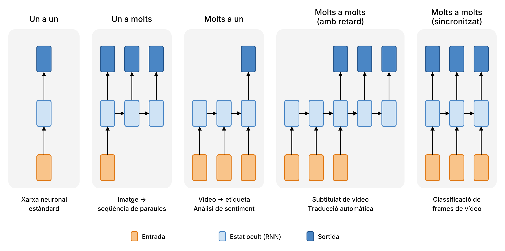
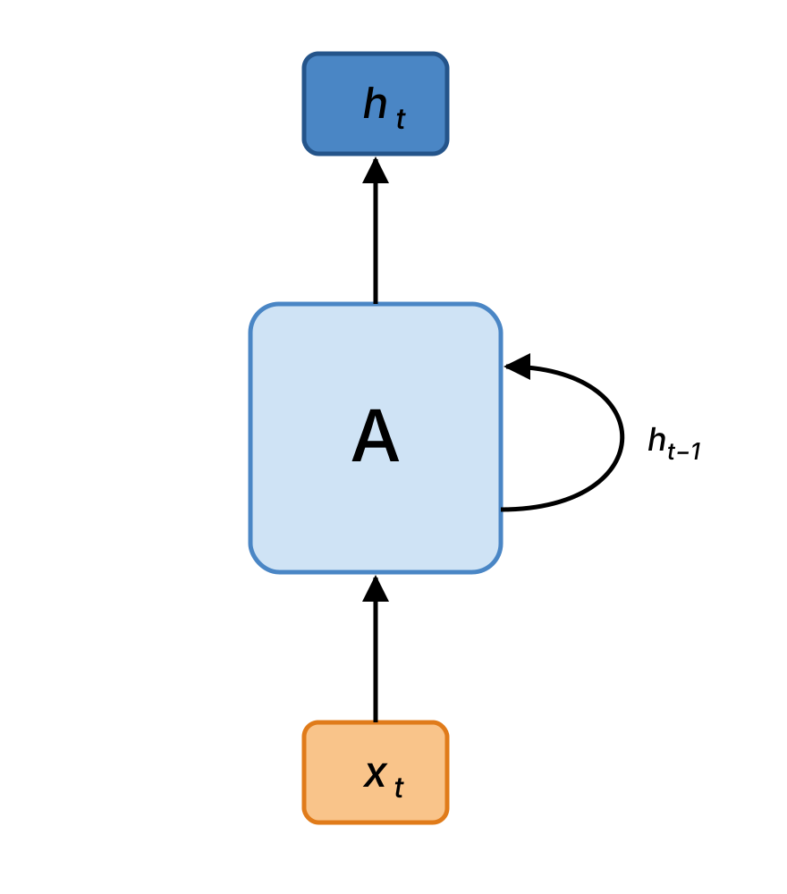
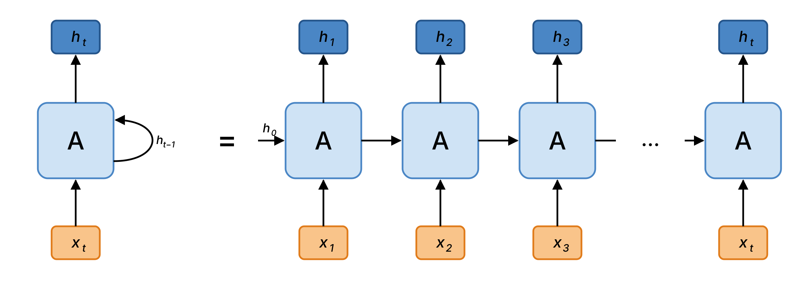
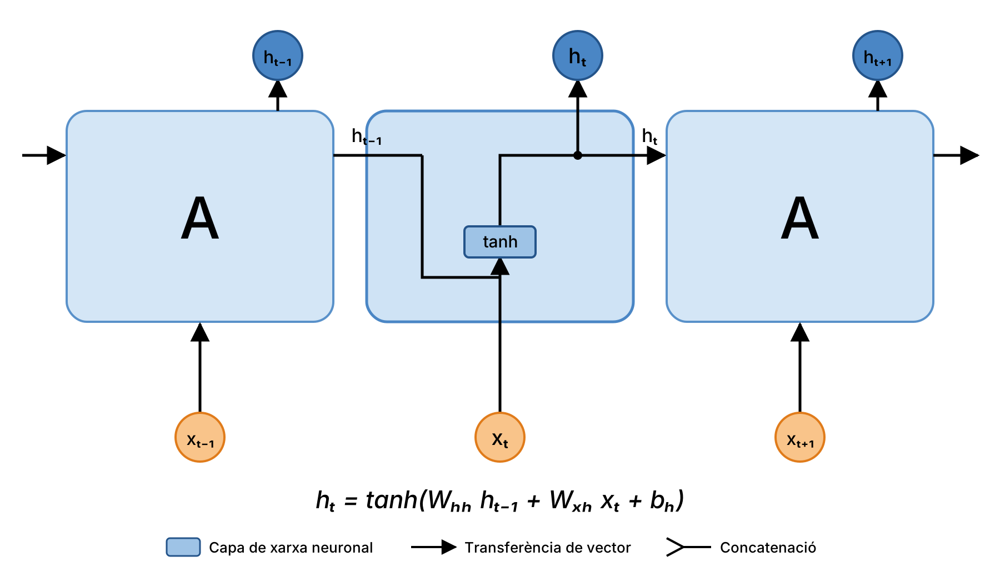
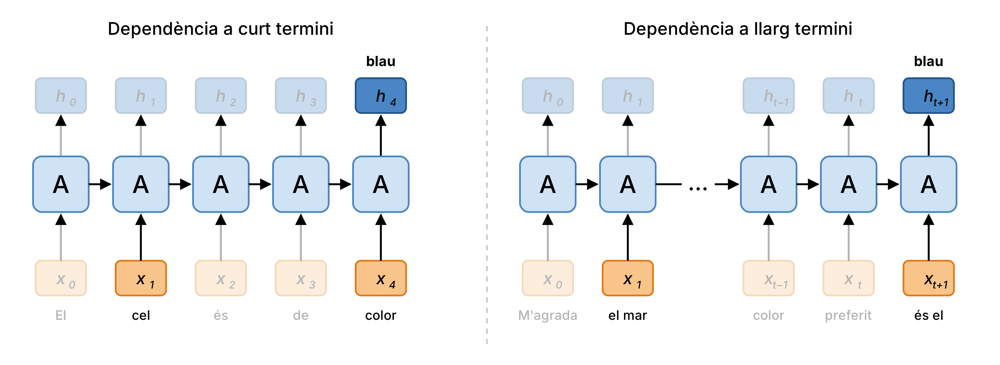
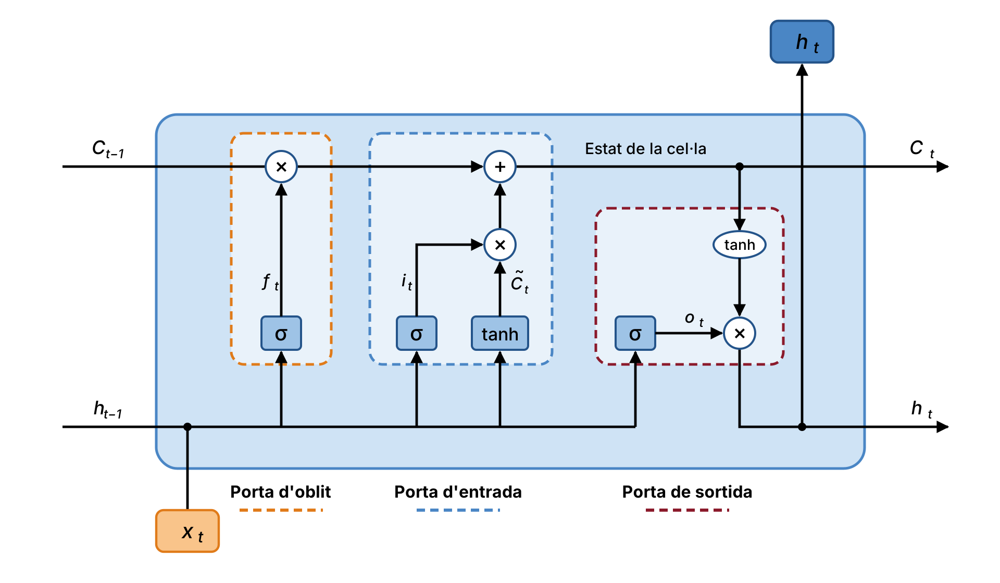
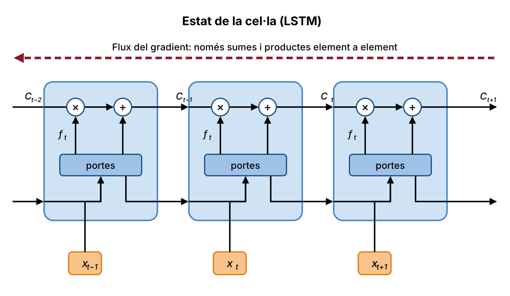

# Xarxes neuronals recurrents

Durant el nostre procés mental, els éssers humans no comencem a pensar des de zero a cada instant. Mentre llegim aquest paràgraf, entenem cada paraula a partir del que hem entès de les paraules anteriors: no oblidem tot el llegit per tornar a començar a cada pas. Els nostres pensaments tenen persistència. 

Les xarxes neuronals que hem vist fins ara no tenen aquesta capacitat. El Perceptró multicapa rep una entrada de mida fixa, calcula una sortida i no conserva cap informació d'una predicció a la següent. Imaginem, per exemple, que volem classificar quin tipus d'esdeveniment passa en cada moment d'una pel·lícula: no sbriem com una xarxa neuronal tradicional podria aprofitar el que ha "vist" en escenes anteriors per interpretar les següents.

Les xarxes neuronals recurrents (*Recurrent Neural Networks*, RNN) neixen precisament per resoldre aquesta limitació. Són xarxes amb bucles interns que permeten que la informació persisteixi al llarg del temps.

## Dades seqüencials

Les RNN (Rumelhart et al., 1986) són una família de xarxes neuronals especialitzades en el processament de dades seqüencials. De la mateixa manera que una xarxa convolucional està especialitzada en processar una graella de valors $\mathbf{X}$, com ara una imatge, una xarxa recurrent està especialitzada a processar una seqüència de valors:

$$\mathbf{x}^{(1)}, \mathbf{x}^{(2)}, \ldots, \mathbf{x}^{(t)}.$$

Exemples de dades seqüencials són el text (una seqüència de paraules o caràcters), l'àudio (una seqüència de mostres en el temps), el vídeo (una seqüència d'imatges) o les sèries temporals (una seqüència de mesures, com l'evolució de la temperatura del mar al llarg de l'any).

Així com les xarxes convolucionals poden escalar fàcilment a imatges de gran amplada i alçada, les xarxes recurrents poden escalar a seqüències molt més llargues del que seria pràctic per a una xarxa sense aquesta especialització. A més, la majoria de xarxes recurrents poden processar **seqüències de longitud variable**, cosa que una xarxa amb una capa d'entrada de mida fixa no pot fer.

## Tipus d'arquitectures

Les RNN ofereixen molta flexibilitat a l'hora de dissenyar l'arquitectura, ja que tant l'entrada com la sortida poden ser un únic element o una seqüència. Les configuracions més habituals són les següents:

{width=300px}

- **Un a un** (*one to one*): una entrada i una sortida de mida fixa. És la xarxa neuronal estàndard que ja coneixem, sense cap recurrència.
- **Un a molts** (*one to many*): a partir d'una única entrada es genera una seqüència. Per exemple, generar la descripció textual d'una imatge (imatge → seqüència de paraules).
- **Molts a un** (*many to one*): a partir d'una seqüència es genera una única sortida. Per exemple, classificar l'acció que apareix en un vídeo (vídeo → etiqueta) o l'anàlisi de sentiment d'un text.
- **Molts a molts** (*many to many*) amb retard: primer es llegeix tota la seqüència d'entrada i després es genera la seqüència de sortida. Per exemple, el subtitulat de vídeo o la traducció automàtica.
- **Molts a molts** (*many to many*) sincronitzat: es genera una sortida per a cada element de l'entrada. Per exemple, la classificació de cadascun dels *frames* del que es composa un vídeo.

## Funcionament d'una RNN

### Estat intern

La característica principal d'una RNN és que disposa d'un estat intern (o estat ocult), $\mathbf{h}$, que s'actualitza a mesura que es processa la seqüència. Aquest estat actua com una memòria que resumeix la informació rellevant dels elements vistos fins al moment.

{width=200px}

La seqüència de vectors $\mathbf{x}$ es processa aplicant a cada pas de temps $t$ la següent fórmula recurrent:

$$\mathbf{h}_t = f_W(\mathbf{h}_{t-1}, \mathbf{x}_t),$$

on:

- $\mathbf{h}_t$ és el nou estat intern.
- $\mathbf{h}_{t-1}$ és l'estat intern del pas anterior.
- $\mathbf{x}_t$ és el vector d'entrada en el pas de temps $t$.
- $f_W$ és una funció amb paràmetres $W$.

La sortida de la xarxa en cada pas de temps es calcula a partir de l'estat intern mitjançant una altra funció amb els seus propis paràmetres $W_{hy}$:

$$\mathbf{y}_t = f_{W_{hy}}(\mathbf{h}_t).$$

### RNN desplegada

Per entendre millor el funcionament d'una RNN, és útil desplegar-la en el temps: el bucle es pot veure com múltiples còpies de la mateixa xarxa, cadascuna de les quals passa un missatge (l'estat $\mathbf{h}$) a la següent.

{width=3
00px}

És important remarcar que a cada pas de temps s'utilitza la mateixa funció $f$ amb el mateix conjunt de paràmetres $W$. Aquesta compartició de paràmetres és la que permet que el model processi seqüències de qualsevol longitud sense que el nombre de paràmetres creixi, i que tracti de la mateixa manera un patró independentment de la posició de la seqüència on aparegui.

L'estat inicial, $\mathbf{h}_0$, normalment s'inicialitza a zero.

## Entrenament: *Backpropagation Through Time*

A causa de la seva naturalesa recurrent, les RNN necessiten una adaptació de l'algoritme *backpropagation* anomenada **Backpropagation Through Time** (BPTT). La idea és senzilla: es desplega la xarxa al llarg de tota la seqüència, es calcula la pèrdua total com la suma de les pèrdues de cada pas de temps:

$$J = \sum_{t=1}^{\tau} J_t(\hat{\mathbf{y}}_t, \mathbf{y}_t).$$

 Llavor s'aplica *backpropagation* sobre la xarxa desplegada com si fos una xarxa xarxa prealimentada (*feed-forward*) molt profunda. Com que els paràmetres són compartits entre tots els passos de temps, el gradient respecte a cada matriu de pesos és la suma de les contribucions de cada pas:

$$\frac{\partial J}{\partial W_{hh}} = \sum_{t=1}^{\tau} \frac{\partial J_t}{\partial W_{hh}}.$$

### RNN estàndard (*vanilla*)

En la seva forma més senzilla, coneguda com a RNN estàndard o *vanilla*, el mòdul que es repeteix és una única capa amb funció d'activació tangent hiperbòlica:

$$\mathbf{h}_t = \tanh\left(W_{hh}\,\mathbf{h}_{t-1} + W_{xh}\,\mathbf{x}_t + \mathbf{b}_h\right),$$

$$\mathbf{y}_t = W_{hy}\,\mathbf{h}_t + \mathbf{b}_y,$$

on $W_{hh}$ és la matriu de pesos que connecta l'estat anterior amb l'estat actual, $W_{xh}$ és la matriu de pesos que connecta l'entrada amb l'estat, $W_{hy}$ és la matriu de pesos que connecta l'estat amb la sortida, i $\mathbf{b}_h$ i $\mathbf{b}_y$ són els biaixos corresponents. A la capa de sortida cal posar la funció d'activació corresponent al problema que es vol resoldre. Per exemple si és un problema de classificació amb múltiples classes posaríem una funció _softmax_.

{width=300px}

#### L'ús de la tangent hiperbòlica en les RNN

En l'estat ocult de les RNN és habitual emprar la tangent hiperbòlica com a funció d'activació, en lloc de la *ReLU* que predomina en altres tipus de xarxes. Hi ha dos motius principals.

En primer lloc, la funció $\tanh$ està fitada: els seus valors sempre es troben entre $-1$ i $1$. Com que l'estat es realimenta a cada pas de temps, amb una funció no fitada com la *ReLU* els valors de l'estat podrien créixer sense control a mesura que avança la seqüència.

En segon lloc, la *ReLU* presenta el problema de les neurones mortes: quan una unitat queda en la regió on la sortida és $0$, el seu gradient també és $0$ i ja no es pot recuperar durant l'entrenament. En una RNN això és especialment greu, perquè les mateixes unitats es reutilitzen a tots els passos de temps i l'estat ocult $\mathbf{h}_t$ és l'única via per on circula la memòria. Si una unitat de l'estat mor, aquella dimensió val $0$ a tots els passos i per a totes les seqüències, i la xarxa perd capacitat de memòria de forma permanent. A més, com veurem a la secció següent, durant l'entrenament de les RNN són freqüents les actualitzacions de pesos molt grans, que són precisament les que poden fer morir les neurones.

#### Gradients que s'esvaeixen o exploten

A la pràctica, les RNN funcionen pitjor a mesura que el context es fa més gran. Si volem predir la darrera paraula de la frase *"El cel és de color..."*, la informació necessària és molt propera i la RNN pot aprendre-la sense problemes (*blau*). En canvi, en una frase com *"M'agrada molt el mar... [molt de text] ... el meu color preferit és el..."*, la informació rellevant es troba molts passos enrere i a la RNN li resulta molt difícil aprofitar-la.

{width=300px}

Aquest problema va ser estudiat en profunditat per Hochreiter (1991) i Bengio *et al.* (1994), que en van trobar les causes fonamentals. Durant el BPTT, per propagar el gradient des del pas $t$ fins a un pas anterior $k$, cal aplicar la regla de la cadena a través de tots els passos intermedis:

$$\frac{\partial \mathbf{h}_t}{\partial \mathbf{h}_k} = \prod_{i=k+1}^{t} \frac{\partial \mathbf{h}_i}{\partial \mathbf{h}_{i-1}} = \prod_{i=k+1}^{t} \text{diag}\left(1 - \mathbf{h}_i^2\right) W_{hh}.$$

És a dir, el gradient implica **multiplicar moltes vegades la mateixa matriu de pesos** $W_{hh}$, cosa que provoca dos problemes greus:

- **Gradient que s'esvaeix** (*vanishing gradient*): si els valors de $W_{hh}$ (formalment, el seu valor singular més gran) són menors que $1$, el gradient es fa cada cop més petit a mesura que retrocedim en el temps. La RNN no pot aprendre dependències llargues, ja que la contribució dels passos llunyans és pràcticament nul·la. A més, la derivada de la $\tanh$ és sempre menor o igual que $1$, cosa que agreuja el problema.
- **Gradient que explota** (*exploding gradient*): si els valors de $W_{hh}$ són majors que $1$, el gradient creix de manera exponencial. Les actualitzacions dels pesos es tornen enormes, els pesos se saturen i apareixen valors `NaN` a la funció de pèrdua.

Per controlar l'explosió del gradient s'empra la tècnica de **retall de gradient** (*gradient clipping*), que limita la norma del gradient a un valor màxim $c$:

$$\text{si } \|\mathbf{g}\| > c \;\Rightarrow\; \mathbf{g} \leftarrow c \cdot \frac{\mathbf{g}}{\|\mathbf{g}\|}.$$

En canvi, el problema del gradient que s'esvaeix no té una solució tan senzilla i requereix canviar l'arquitectura de la xarxa, com veurem amb les LSTM.

## Avantatges i limitacions de les RNN
Les RNN tenen diversos avantatges a l'hora de treballar amb dades seqüencials. Poden processar entrades de qualsevol longitud i, com que s'apliquen els mateixos pesos a cada pas de temps, la mida del model no augmenta quan les entrades són més llargues. Aquesta compartició de pesos fa també que totes les entrades es processin de la mateixa manera, independentment de la posició que ocupin a la seqüència. A més, en teoria, el càlcul en el pas $t$ pot aprofitar informació de molts passos enrere.

Tanmateix, presenten dues limitacions importants. D'una banda, el càlcul recurrent és lent, ja que cada pas depèn del resultat de l'anterior i, per tant, no es pot paral·lelitzar al llarg de la seqüència. De l'altra, tot i que en teoria poden recordar informació llunyana, a la pràctica els costa molt accedir a la informació de molts passos enrere, a causa del problema del gradient que s'esvaeix.

## Xarxes LSTM

Les xarxes de **memòria a llarg i curt termini** (*Long Short-Term Memory*, LSTM), proposades per Hochreiter i Schmidhuber (1997), són un tipus especial de RNN dissenyat explícitament per aprendre dependències a llarg termini.

Totes les xarxes recurrents tenen la forma d'una cadena de mòduls que es repeteixen. En les RNN estàndard, aquest mòdul té una estructura molt simple: una sola capa $\tanh$. Les LSTM també tenen aquesta estructura de cadena, però el mòdul recurrent és diferent: en lloc d'una sola capa de xarxa neuronal, n'hi ha **quatre**, que interactuen d'una manera molt particular.

{width=300px}

### L'estat de la cel·la

La clau de les LSTM és l'**estat de la cel·la**, $\mathbf{C}_t$, representat per la línia horitzontal que travessa la part superior del diagrama. L'estat de la cel·la funciona com una cinta transportadora: recorre tota la cadena amb només algunes interaccions lineals menors, de manera que la informació pot fluir al llarg d'ella pràcticament sense canvis.

La LSTM pot eliminar o afegir informació a l'estat de la cel·la, de manera regulada per unes estructures anomenades portes (*gates*). Les portes són una manera de deixar passar informació de manera selectiva i estan formades per una capa amb funció d'activació sigmoide i una multiplicació element a element. La sigmoide genera valors entre $0$ i $1$ que indiquen quina proporció de cada component s'ha de deixar passar: un valor de $0$ significa "no deixis passar res", mentre que un valor de $1$ significa "deixa-ho passar tot".

Una LSTM té tres portes per protegir i controlar l'estat de la cel·la: la porta d'oblit, la porta d'entrada i la porta de sortida. En totes les equacions següents, $[\mathbf{h}_{t-1}, \mathbf{x}_t]$ indica la concatenació de l'estat ocult anterior i l'entrada actual i $\sigma$ és la funció sigmoide.

### Porta d'oblit

El primer pas de la LSTM és decidir quina informació es descarta de l'estat de la cel·la. Aquesta decisió la pren una capa sigmoide anomenada **porta d'oblit** (*forget gate*). A partir de $\mathbf{h}_{t-1}$ i $\mathbf{x}_t$, genera un valor entre $0$ i $1$ per a cada component de l'estat de la cel·la $\mathbf{C}_{t-1}$:

$$\mathbf{f}_t = \sigma\left(W_f \cdot [\mathbf{h}_{t-1}, \mathbf{x}_t] + \mathbf{b}_f\right).$$

### Porta d'entrada

El segon pas és decidir quina informació nova s'emmagatzema a l'estat de la cel·la. Això es fa en dues parts:

- Una capa sigmoide anomenada **porta d'entrada** (*input gate*) decideix quins valors s'actualitzen:

$$\mathbf{i}_t = \sigma\left(W_i \cdot [\mathbf{h}_{t-1}, \mathbf{x}_t] + \mathbf{b}_i\right).$$

- Una capa $\tanh$ crea un vector de nous valors candidats, $\tilde{\mathbf{C}}_t$, que es podrien afegir a l'estat:

$$\tilde{\mathbf{C}}_t = \tanh\left(W_C \cdot [\mathbf{h}_{t-1}, \mathbf{x}_t] + \mathbf{b}_C\right).$$

### Actualització de l'estat de la cel·la

Ara ja es pot actualitzar l'estat antic de la cel·la, $\mathbf{C}_{t-1}$, al nou estat $\mathbf{C}_t$. Es multiplica l'estat antic per $\mathbf{f}_t$, oblidant la informació que s'ha decidit descartar, i després s'hi suma $\mathbf{i}_t \odot \tilde{\mathbf{C}}_t$, és a dir, els nous valors candidats escalats segons quant s'ha decidit actualitzar cada component:

$$\mathbf{C}_t = \mathbf{f}_t \odot \mathbf{C}_{t-1} + \mathbf{i}_t \odot \tilde{\mathbf{C}}_t,$$

on $\odot$ indica el producte element a element.

### Porta de sortida

Finalment, cal decidir la sortida, que es basarà en l'estat de la cel·la però en serà una versió filtrada. Primer, una capa sigmoide anomenada **porta de sortida** (*output gate*) decideix quines parts de l'estat de la cel·la es generaran com a sortida. Després, es passa l'estat de la cel·la per la funció $\tanh$ (per obtenir valors entre $-1$ i $1$) i es multiplica per la sortida de la porta, de manera que només es generen les parts escollides:

$$\mathbf{o}_t = \sigma\left(W_o \cdot [\mathbf{h}_{t-1}, \mathbf{x}_t] + \mathbf{b}_o\right),$$

$$\mathbf{h}_t = \mathbf{o}_t \odot \tanh\left(\mathbf{C}_t\right).$$

### Resum de les equacions

$$
\begin{aligned}
\mathbf{f}_t &= \sigma\left(W_f \cdot [\mathbf{h}_{t-1}, \mathbf{x}_t] + \mathbf{b}_f\right), \\
\mathbf{i}_t &= \sigma\left(W_i \cdot [\mathbf{h}_{t-1}, \mathbf{x}_t] + \mathbf{b}_i\right), \\
\tilde{\mathbf{C}}_t &= \tanh\left(W_C \cdot [\mathbf{h}_{t-1}, \mathbf{x}_t] + \mathbf{b}_C\right), \\
\mathbf{o}_t &= \sigma\left(W_o \cdot [\mathbf{h}_{t-1}, \mathbf{x}_t] + \mathbf{b}_o\right), \\
\mathbf{C}_t &= \mathbf{f}_t \odot \mathbf{C}_{t-1} + \mathbf{i}_t \odot \tilde{\mathbf{C}}_t, \\
\mathbf{h}_t &= \mathbf{o}_t \odot \tanh\left(\mathbf{C}_t\right).
\end{aligned}
$$

### Beneficis de les LSTM

L'arquitectura LSTM facilita que la xarxa preservi informació durant molts passos de temps. Per exemple, si $\mathbf{f}_t = 1$ i $\mathbf{i}_t = 0$, la informació de l'estat de la cel·la es conserva indefinidament. En canvi, per a una RNN estàndard és molt més difícil aprendre una matriu de pesos recurrent $W_{hh}$ que preservi la informació en l'estat ocult.

Des del punt de vista de l'entrenament, l'estat de la cel·la s'actualitza mitjançant una suma i una multiplicació element a element, en lloc d'una multiplicació per una matriu de pesos seguida d'una funció d'activació. Per això, durant la retropropagació, el gradient que viatja a través de l'estat de la cel·la només es multiplica per les portes d'oblit:

$$\frac{\partial \mathbf{C}_t}{\partial \mathbf{C}_{t-1}} \approx \mathbf{f}_t,$$

de manera que el flux del gradient no s'interromp. Aquesta idea és molt similar a la de les connexions residuals de les xarxes ResNet.

{width=300px}
El gradient flueix a través de l’estat de la cel·la sense interrompre’s, ja que només travessa sumes i productes element a element.

Cal tenir present que una LSTM no garanteix que el gradient no s'esvaeixi o exploti; el que fa és proporcionar al model una manera més fàcil d'aprendre dependències de llarga distància.

La implementació de les LSTM està disponible a les principals biblioteques d'aprenentatge profund. Podeu consultar-ne els detalls a la [documentació de PyTorch](https://pytorch.org/docs/stable/generated/torch.nn.LSTM.html).

## Aplicacions

A continuació descriurem algunes de les aplicacions d'aquests tipus xarxes

### Representació del text

Per poder processar text amb una xarxa neuronal, primer cal convertir cada paraula en un vector numèric. Una de les tècniques més conegudes és **Word2Vec**, que aprèn un vector de significat per a cada paraula de manera que les paraules que apareixen en contextos similars tinguin vectors similars. Per aconseguir-ho, entrena una xarxa neuronal que intenta predir les paraules del context a partir d'una paraula central (o a l'inrevés). D'aquesta manera, una frase es converteix en una seqüència de vectors $\mathbf{x}^{(1)}, \ldots, \mathbf{x}^{(t)}$ que pot ser processada per una RNN.

### Subtitulat d'imatges

Una de les aplicacions més conegudes de les RNN és la generació automàtica de descripcions d'imatges (*image captioning*). La idea consisteix a combinar una xarxa convolucional (CNN), que extreu un vector de característiques de la imatge, amb una RNN que genera la descripció paraula a paraula.

<figure style="text-align: center;">
    
    <figcaption>Subtitulat d'imatges combinant una CNN i una RNN (font: Karpathy i Fei-Fei).</figcaption>
</figure>

El procés és el següent:

1. Es pren una CNN preentrenada (per exemple, VGG) i **s'elimina la darrera capa** de classificació. La sortida de la penúltima capa completament connectada (`FC-4096`) s'utilitza com a vector de característiques de la imatge, $\mathbf{v}$.

2. Aquest vector s'incorpora a l'actualització de l'estat de la RNN mitjançant una nova matriu de pesos $W_{ih}$. L'actualització de l'estat passa de:

$$\mathbf{h} = \tanh\left(W_{xh}\,\mathbf{x} + W_{hh}\,\mathbf{h}\right)$$

a:

$$\mathbf{h} = \tanh\left(W_{xh}\,\mathbf{x} + W_{hh}\,\mathbf{h} + W_{ih}\,\mathbf{v}\right).$$

3. La primera entrada de la RNN és un *token* especial `<START>`, que indica l'inici de la frase. La RNN calcula la sortida $\mathbf{y}_0$, que és una distribució de probabilitat sobre el vocabulari, i se'n **mostreja** una paraula (per exemple, *"straw"*).

4. La paraula generada s'utilitza com a entrada del següent pas de temps, que genera una nova paraula (*"hat"*), i així successivament.

5. El procés acaba quan la RNN genera el *token* especial `<END>`.

Alguns dels treballs més rellevants en aquesta línia són:

- *Explain Images with Multimodal Recurrent Neural Networks*, Mao et al.
- *Deep Visual-Semantic Alignments for Generating Image Descriptions*, Karpathy i Fei-Fei.
- *Show and Tell: A Neural Image Caption Generator*, Vinyals et al.
- *Long-term Recurrent Convolutional Networks for Visual Recognition and Description*, Donahue et al.
- *Learning a Recurrent Visual Representation for Image Caption Generation*, Chen i Zitnick.

### Resposta a preguntes visuals

En la tasca de resposta a preguntes visuals (*Visual Question Answering*, VQA), el model rep una imatge i una pregunta en llenguatge natural sobre la imatge, i ha de generar-ne la resposta. Per exemple, davant de la imatge d'un camió decorat i la pregunta *"Quin animal en perill d'extinció apareix al camió?"*, el model ha de respondre *"Un àguila de cap blanc"*.

### Diàleg visual

El diàleg visual (*Visual Dialog*) va un pas més enllà: el model ha de mantenir una conversa sobre una imatge, responent preguntes successives i tenint en compte el context de les preguntes i respostes anteriors.

## Conclusions

- Les RNN permeten molta flexibilitat en el disseny d'arquitectures per treballar amb dades seqüencials (un a molts, molts a un, molts a molts).
- Les RNN estàndard són simples, però a la pràctica no funcionen gaire bé amb seqüències llargues.
- Les variants més complexes, com les LSTM, introdueixen mecanismes (portes) per decidir de manera selectiva quina informació es conserva, s'afegeix o es transmet.
- Les RNN s'entrenen amb *Backpropagation Through Time*. El flux invers dels gradients pot explotar o esvair-se: l'explosió es controla amb el retall de gradients, mentre que l'esvaïment s'aborda amb arquitectures com les LSTM.
- La recerca d'arquitectures millors o més senzilles, així com de nous paradigmes per raonar sobre seqüències, continua sent un tema molt actiu.

## Bibliografia

- Olah, C. (2015). *Understanding LSTM Networks*. https://colah.github.io/posts/2015-08-Understanding-LSTMs/
- Curs CS231n, Stanford University. *Lecture 7: Recurrent Neural Networks*.
- Hochreiter, S. (1991). *Untersuchungen zu dynamischen neuronalen Netzen*. Tesi de diploma, Technische Universität München.
- Bengio, Y., Simard, P. i Frasconi, P. (1994). *Learning long-term dependencies with gradient descent is difficult*. IEEE Transactions on Neural Networks, 5(2), 157–166.
- Hochreiter, S. i Schmidhuber, J. (1997). *Long Short-Term Memory*. Neural Computation, 9(8), 1735–1780.
- Rumelhart, D. E., Hinton, G. E. i Williams, R. J. (1986). *Learning representations by back-propagating errors*. Nature, 323, 533–536.
